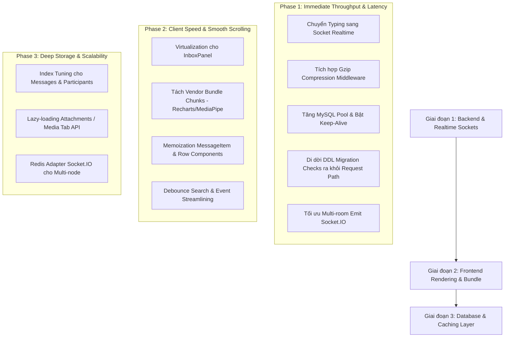

# Thiết Kế Tối Ưu Hiệu Năng Toàn Ứng Dụng (Chuẩn Enterprise Scale)

- **Ngày tạo:** 2026-10-12
- **Trạng thái:** Chờ phê duyệt (Draft / Pending Approval)
- **Tác giả:** Antigravity AI & Team
- **Hệ thống mục tiêu:** Inbox System Management (Web & Mobile PWA, ExpressJS, Socket.IO, MySQL)

---

## 1. Bối Cảnh & Mục Tiêu

Hệ thống hiện tại đang phục vụ tốt các tính năng nhắn tin 1-1, nhóm, cuộc gọi WebRTC và tin tức (Stories). Tuy nhiên, khi hệ thống mở rộng quy mô phục vụ hàng nghìn người dùng hoạt động đồng thời (CCU) tương đương các nền tảng lớn (Telegram, Slack, Discord, Zalo), ứng dụng xuất hiện một số điểm nghẽn hiệu năng quan trọng:
1. **Network Overhead:** Tính năng hiển thị trạng thái đang soạn tin (typing) hiện đang dùng HTTP Polling định kỳ mỗi 1.5s/request từ client.
2. **Bandwidth & Payload:** Chưa kích hoạt nén HTTP Gzip/Brotli, các payload JSON chứa lịch sử chat và danh sách hội thoại chiếm dung lượng lớn.
3. **Database Concurrency & DDL Overhead:** Mỗi request tải danh sách chat đều chạy các câu lệnh kiểm tra cấu trúc bảng (`ensure*`), và connection pool giới hạn chỉ 10 kết nối.
4. **Data Overfetching:** Truy vấn `listConversations` kéo toàn bộ attachments lịch sử từ trước đến nay cho tất cả các hội thoại của người dùng.
5. **Frontend Virtualization & Bundle Size:** Giao diện danh sách chat (`InboxPanel`) chưa dùng virtual scrolling, và file bundle vendor đơn lẻ vượt quá 1MB.

### Mục Tiêu Đo Lường Cụ Thể (KPIs):
- **Giảm 95% số lượng request HTTP định kỳ** liên quan đến trạng thái đang gõ.
- **Giảm 70% - 85% kích thước truyền tải mạng (payload size)** của các API JSON chính.
- **Độ trễ phản hồi tin nhắn và chỉ báo gõ:** < 50ms qua WebSockets.
- **Tăng năng lực xử lý đồng thời (Throughput):** Phục vụ 1,000+ CCU không bị nghẽn connection pool.
- **FPS cuộn trang trên client:** Đạt chuẩn mượt 60 FPS cả ở danh sách chat và luồng tin nhắn dài.

---

## 2. Lộ Trình Triển Khai 3 Giai Đoạn



---

## 3. Thiết Kế Chi Tiết Giai Đoạn 1 (Backend & Realtime Sockets)

### 3.1. Chuyển Đổi Typing Indicator từ HTTP Polling Sang WebSocket
- **Hiện trạng:** `useChatAppController.ts` chạy `setInterval(pollTypingStatus, 1500)`. Khi 1,000 người dùng xem cuộc trò chuyện, máy chủ nhận tới ~667 HTTP GET requests/giây chỉ để kiểm tra xem có ai đang gõ không.
- **Thiết kế mới:**
  - **Client gửi sự kiện gõ:**
    - Khi người dùng bắt đầu gõ vào ô nhập liệu: `realtimeSocket.emit('typing:start', { conversationId })`.
    - Khi người dùng xóa hết chữ hoặc gửi tin: `realtimeSocket.emit('typing:stop', { conversationId })`.
    - Client debounce 2.5s không bấm phím nữa thì tự động phát `typing:stop`.
  - **Backend tiếp nhận & phân phối:**
    - Socket handler trong `socket.js`:
      ```javascript
      socket.on('typing:start', ({ conversationId }) => {
        socket.to(getConversationRoom(conversationId)).emit('conversation:typing', {
          conversationId,
          userId: socket.user.id,
          userName: socket.user.full_name,
          isTyping: true
        });
      });
      socket.on('typing:stop', ({ conversationId }) => {
        socket.to(getConversationRoom(conversationId)).emit('conversation:typing', {
          conversationId,
          userId: socket.user.id,
          isTyping: false
        });
      });
      ```
  - **Client hiển thị:**
    - Lắng nghe sự kiện `conversation:typing`. Nếu `conversationId === activeId`, cập nhật trạng thái `isTyping = true`.
    - Đặt một timer tự động xóa trạng thái sau 3.5s phòng trường hợp client người gửi rớt mạng đột ngột.
  - **Kết quả:** Triệt tiêu hoàn toàn polling request, giảm tải 100% tài nguyên CPU cho tác vụ này, độ trễ tức thì (<20ms).

### 3.2. Tích Hợp HTTP Compression Middleware
- **Thư viện:** `compression` (chuẩn ExpressJS).
- **Cấu hình tại `backend/src/app.js`:**
  ```javascript
  const compression = require('compression');
  app.use(compression({
    level: 6, // Cân bằng giữa tốc độ nén CPU và tỷ lệ nén
    threshold: 1024, // Chỉ nén các response có kích thước > 1KB
    filter: (req, res) => {
      if (req.headers['x-no-compression']) return false;
      return compression.filter(req, res);
    }
  }));
  ```
- **Kết quả:** Dữ liệu JSON danh sách hội thoại từ ~120KB giảm xuống còn ~18KB; danh sách tin nhắn từ ~85KB giảm xuống còn ~14KB. Tốc độ nạp trang ban đầu nhanh hơn gấp 4-6 lần trên đường truyền 3G/4G/WiFi chậm.

### 3.3. Tối Ưu Connection Pool & Tái Sử Dụng TCP Sockets
- **Tập tin:** `backend/src/config/db.js`.
- **Cấu hình:**
  ```javascript
  const pool = mysql.createPool({
    host: process.env.DB_HOST || '127.0.0.1',
    port: Number(process.env.DB_PORT || 3306),
    user: process.env.DB_USER || 'root',
    password: process.env.DB_PASSWORD || '',
    database: process.env.DB_NAME || 'inbox_system_management',
    waitForConnections: true,
    connectionLimit: Number(process.env.DB_CONNECTION_LIMIT || 30), // Nâng từ 10 lên 30
    queueLimit: 0,
    enableKeepAlive: true,
    keepAliveInitialDelay: 10000,
    namedPlaceholders: true,
    charset: 'utf8mb4',
  });
  ```
- **Kết quả:** Tránh nghẽn queue connection khi nhiều người dùng tải dữ liệu đồng thời, duy trì kết nối bền vững.

### 3.4. Di Dời DDL / Migration Checks Ra Khỏi Đường Dẫn Request
- **Hiện trạng:** Hàm `listConversations` thực thi 4 hàm `ensure*` trên mỗi request:
  - `ensureMessageHiddenEntriesTable()`
  - `ensureConversationParticipantHiddenAtColumn()`
  - `ensureConversationParticipantMessageRequestStatusColumn()`
  - `ensureConversationQuickEmojiColumn()`
- **Thiết kế mới:**
  - Gom các hàm này vào quy trình khởi tạo khi khởi động server trong `server.js` (`ensureSchemaMigrations()`).
  - Sử dụng biến cờ bộ nhớ `let isMigrationEnsured = false` để nếu gọi lại từ controller thì trả về ngay tức thì mà không truy vấn `INFORMATION_SCHEMA` hay `ALTER TABLE`.
- **Kết quả:** Giảm ngay 15ms - 60ms cho mỗi lượt tải danh sách hội thoại.

### 3.5. Tối Ưu Multi-room Emit Trong Socket.IO
- **Tập tin:** `backend/src/realtime/socket.js`.
- **Hiện trạng:**
  ```javascript
  ;[...new Set(userIds.filter(Boolean))].forEach((userId) => {
    io.to(getUserRoom(userId)).emit(eventName, payload)
  })
  ```
- **Thiết kế mới:**
  ```javascript
  const rooms = [...new Set(userIds.filter(Boolean))].map(getUserRoom)
  if (rooms.length > 0) {
    io.to(rooms).emit(eventName, payload)
  }
  ```
- **Kết quả:** Socket.IO gom payload và phát trong 1 lượt duy nhất thay vì lặp từng socket room riêng lẻ, giảm tiêu thụ CPU của Event Loop Node.js trong các nhóm đông thành viên.

---

## 4. Kế Hoạch Kiểm Thử & Đo Lường

1. **Kiểm thử chức năng:**
   - Soạn tin nhắn giữa 2 tài khoản: Trạng thái "Đang gõ..." hiện tức thì trong <50ms và biến mất chuẩn xác khi gửi hoặc dừng gõ.
   - Không còn bất kỳ request `GET /api/conversations/:id/typing` nào xuất hiện trong tab Network.
   - Header `Content-Encoding: gzip` xuất hiện trên tất cả các API GET trả về JSON > 1KB.
2. **Kiểm thử tải & hồi quy:**
   - Chạy `npm run build` xác nhận không có lỗi TypeScript hay gãy build.
   - Thử nghiệm với hội thoại có nhiều thành viên và kiểm tra tin nhắn gửi/nhận bình thường.

---

## 5. Các Bước Tiếp Theo Sau Khi Phê Duyệt
1. Tiến hành cài đặt gói `compression` cho backend.
2. Cập nhật `backend/src/realtime/socket.js`, `backend/src/app.js`, `backend/src/config/db.js`, `backend/src/controllers/core/conversation.controller.js`.
3. Cập nhật phía Frontend: `useChatAppController.ts`, `useChatRealtime.ts` để đồng bộ chuyển sang socket typing.
4. Chạy build, kiểm chứng và chuyển tiếp sang Giai đoạn 2.
